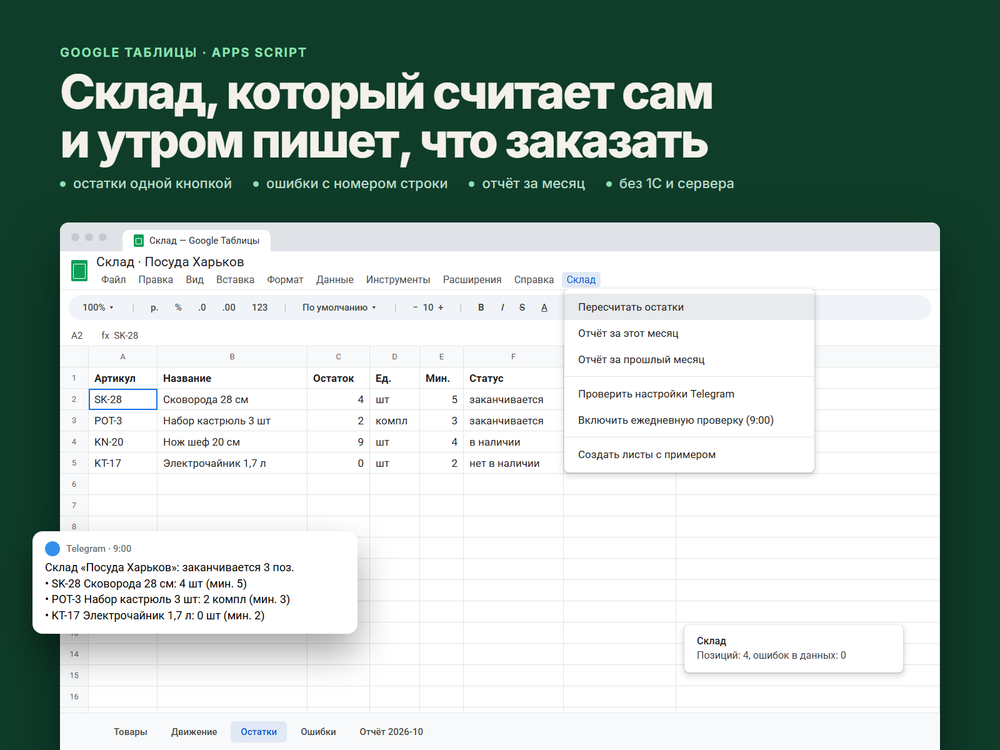

# Sheets Inventory

Учёт склада в Google Таблице на Apps Script, для магазина, мастерской или небольшого производства. Товары и движения вносятся в обычные листы, а скрипт одной кнопкой считает остатки, делает отчёт за месяц, находит ошибки в данных и каждое утро пишет в Telegram, какие товары заканчиваются. Сервер, хостинг и 1С не нужны.



## Как это выглядит в таблице

| Лист | Кто заполняет | Что там |
|---|---|---|
| **Товары** | вы | Артикул, название, единица, минимальный остаток, цена закупки |
| **Движение** | вы | Дата, артикул, тип (приход / расход / списание), количество, комментарий |
| **Остатки** | скрипт | Остаток по каждому товару, статус («в наличии», «заканчивается», «нет в наличии»), стоимость остатка |
| **Отчёт ГГГГ-ММ** | скрипт | За месяц: приход, расход, списание, остаток на конец месяца |
| **Ошибки** | скрипт | Строки, которые не учтены, с номером строки и причиной |

В таблице появляется меню **«Склад»**: пересчитать остатки, отчёт за этот или прошлый месяц, проверить настройки Telegram, включить ежедневную проверку. Пункты меню ничего не спрашивают: никаких окон ввода, результат во всплывающей подсказке.

## Что проверяется

- Дата: `31.01.2030`, `2030-01-31` или ячейка-дата. Несуществующие даты (31.02) и даты в будущем не принимаются
- Артикул должен быть в листе «Товары». Регистр не важен: `sk-28` и `SK-28` — один товар. Повтор артикула в справочнике — ошибка
- Тип движения: приход / расход / продажа / списание, в том числе по-украински
- Количество: число больше нуля, можно `1 234,5`. Дробные количества (кг, м) складываются без ошибок округления
- Остаток ушёл в минус: в «Ошибках» будет строка, на которой это случилось, чтобы найти забытый приход

## Безопасность

- **Формулы из чужого текста не выполняются.** Если в названии товара или комментарии окажется `=IMPORTXML(...)` или `=HYPERLINK(...)`, в листах «Остатки», «Отчёт» и «Ошибки» это будет обычный текст. Иначе любой, кто может вписать строку, мог бы заставить таблицу отправить данные на чужой сайт
- **Минимальные права скрипта:** только эта таблица (а не весь Google Диск), меню, триггер и внешние запросы. Внешние запросы разрешены **только** на `api.telegram.org`, это задано в манифесте
- **Токен Telegram не хранится в таблице.** Он лежит в настройках скрипта, которые видят только редакторы скрипта. В тексты ошибок и логи токен не попадает
- Сообщения в Telegram уходят обычным текстом: название товара не может внедрить разметку или ссылку
- Листы, которые заполняет скрипт, защищены предупреждением от случайной правки руками
- Два одновременных пересчёта не перемешивают данные: второй ждёт или получает отказ
- Скрипт с примером данных никогда не перезаписывает уже заполненный лист «Товары»

## Как это устроено

```
src/
  core.js          учёт: проверки, остатки, отчёт, текст уведомления (без сервисов Google)
  sheets.js        листы, меню, триггер, Telegram (Apps Script)
  appsscript.json  манифест: часовой пояс, права, разрешённый адрес Telegram
test/              29 тестов (Node.js, без сторонних библиотек)
```

Логика учёта не зависит от Google, поэтому проверяется тестами на компьютере. Сервисы Google (листы, меню, блокировка, настройки, отправка запросов) в тестах заменены имитацией, которая ведёт себя как Google Таблицы: строка, начинающаяся с `=`, становится формулой. Так атаки с формулами проверяются по-настоящему. Отдельный тест загружает файлы так, как это делает Apps Script (общая глобальная область, без `require`), и нажимает пункты меню.

## Установка (10 минут)

1. Создайте Google Таблицу.
2. **Расширения → Apps Script.**
3. В редакторе: шестерёнка **«Настройки проекта»** → включите **«Показывать файл манифеста appsscript.json»**.
4. Скопируйте содержимое трёх файлов из `src/` в одноимённые файлы проекта: `core.js` → файл `core`, `sheets.js` → файл `sheets`, `appsscript.json` → `appsscript.json`. Сохраните.
5. Обновите страницу таблицы: появится меню **«Склад»**.
6. **Склад → Создать листы с примером** (при первом запуске Google попросит разрешения; список прав короткий, см. «Безопасность»).
7. **Склад → Пересчитать остатки.**

Уведомления в Telegram:

1. В редакторе Apps Script: шестерёнка **«Настройки проекта»** → **«Свойства скрипта»** → добавьте `TG_TOKEN` (токен бота от @BotFather) и `TG_CHAT_ID` (ваш chat id, узнать: @userinfobot). Таблицу эти настройки не видят, их видят только редакторы скрипта.
2. В таблице: **Склад → Проверить настройки Telegram**.
3. **Склад → Включить ежедневную проверку**.

Для разработчиков: проект можно загружать через [clasp](https://github.com/google/clasp) (`clasp push` из папки `src`).

## Тесты

```bash
npm test        # или: node --test test/
```

## Лицензия

MIT
